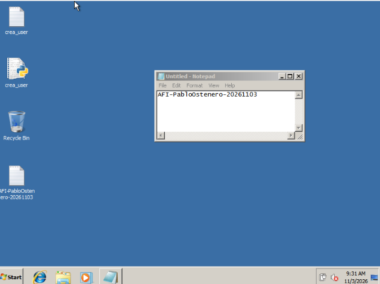

# Notas de trabajo · Adquisición de FORENSIC_10

## 0. Datos del caso y entorno

| Dato | Valor |
|---|---|
| Máquina investigada | `FORENSIC_10` (VirtualBox), Windows 7 SP1 de 32 bits (`manage-bde` versión 6.1.7601), PowerShell 2.0 |
| Memoria de la VM | 1024 MB |
| USB de respuesta | Unidad `D:` dentro de la VM, etiqueta «Pen profesor», 3,56 GB. |
| Anfitrión | Sistema Operativo Windows 7 |

Observación: VirtualBox muestra el tipo de SO de la VM como «Windows Vista (64-bit)», mientras que el sistema invitado es Windows 7 de 32 bits.

## 1. Preparación

### 1.1 USB de respuesta
- Formato: NTFS
- Herramientas copiadas a `D:\USB-RESPUESTA\`: DumpIt, script respuesta-en-vivo.ps1, velociraptor
- Hashes SHA-256 de cada herramienta, calculados antes de empezar y guardados en `hashes-herramientas.txt`.
- El `.exe` de Velociraptor 0.77.3 legacy que venía con el material coincide con el hash del `LEEME`: `89034042c0b956ce071cc5c23c0409702a2a3a463c7fd935c888ff7f3f26fb4f`.
- Hash de `velociraptor-v0.76.1-windows-386-legacy.exe` (versión que finalmente funcionó): ecafdd1122ffc02d933337a87fd9fef1cff5af5a

## 2. Marca de autoría (2026-11-03 09:32)

1. Bloc de notas abierto, sin guardar, con el texto: `AFI-PabloOstenero-20261103`. Hora: [09:32]
2. Fichero `AFI-PabloOstenero-20261103.txt` creado en el escritorio con el mismo texto. Hora: [09:32]

Es la única escritura deliberada en el equipo investigado (excepción prevista en el enunciado).

## 3. Parte 1 · Adquisición en vivo

### 3.1 Estado inicial (2026-11-03 09:34)
- Captura de la pantalla inicial: 
- Hora del sistema (`Get-Date`): 09:34. Zona horaria: UTC+1.
- Hora real (referencia): 09:34. Desfase: 00:00.

### 3.2 Memoria RAM (2026-11-05 13:53 – 14:02)
- Herramienta: DumpIt, versión 1.3.2.20110401.
- Ejecutada desde el USB, como administrador, con salida al USB.
- Fichero: FORENSE-06-20261105-125305.raw, tamaño 0.99 GB.
- Hash SHA-256 (`certutil -hashfile <fichero> SHA256`; PowerShell 2.0 no tiene `Get-FileHash`): BBE1DDB8ECE31D8C4960F4A722433D496BAF42B64F2BE8B38C69B1D8FA935A97. Hora del cálculo: 16:10.

### 3.3 Datos volátiles (2026-11-06 16:39 - 16:49)
- Herramienta: `respuesta-en-vivo.ps1`, ejecutado desde el USB con PowerShell abierto como administrador.
- **Incidencias** (véase sección 7, nº 1 y 2): el script original falló en PowerShell 2.0. Se adaptó una versión compatible.
- Cambios de la versión adaptada: `$PSScriptRoot` sustituido por `$MyInvocation`; `Get-CimInstance` por `Get-WmiObject`; los cmdlets de red y usuarios por `netstat`, `net` y WMI; `Get-BitLockerVolume` por `manage-bde -status`; `Get-FileHash` por SHA-256 de .NET; fichero solo en ASCII.
- Salida: carpeta con `00-registro.txt` y `hashes-sha256.csv`. Hash del registro: 00f15cc923ab92aaeb3910203fae48eebadb7ff7f794f7c2fe31751697435d05. Hash del CSV: ec065f3a2e45990258cb27a8364ed0bb90a859acc704241b4f9a7406f5dab26b.

### 3.4 Tráfico de red (captura parcial)
Se captura desde fuera de la VM, sin instalar nada en ella, con VirtualBox en el anfitrión.

**Primer intento (17:02).** Se fijó la ruta y se activó la captura con:
```
VBoxManage controlvm "FORENSIC_10" nictracefile1 D:\salida\CASO-01\red.pcap
VBoxManage controlvm "FORENSIC_10" nictrace1 on
```
`VBoxManage showvminfo "FORENSIC_10" | findstr /i "NIC Trace"` mostró `Trace: off (file: D:\salida\CASO-01\red.pcap)` y `dir` confirmó que ni `D:\salida` ni `D:\salida\CASO-01` existían. VirtualBox guardó la ruta pero no creó la carpeta, y no se escribió ningún `.pcap`. **No existe captura del tramo anterior** (RAM, volátiles y triaje).

**Segundo intento.**
```
mkdir D:\salida\CASO-01
VBoxManage controlvm "FORENSIC_10" nictracefile1 D:\salida\CASO-01\red.pcap
VBoxManage controlvm "FORENSIC_10" nictrace1 on
```
- Hora de activación: 2026-11-07 16:59.
- Hora de desactivación (`nictrace1 off`): 17:05.
- Tamaño de `red.pcap`: 123KB. Hash (`certutil -hashfile D:\salida\CASO-01\red.pcap SHA256`): 33228a768a8cd23f59356bc1194430610a604e43c907d231206194218f02f43d.
- **La captura es parcial:** empieza después de la RAM, los volátiles y el triaje.

### 3.5 Triaje

**Herramienta y por qué.** El enunciado exige KAPE o un recolector offline de Velociraptor. Se probó KAPE primero y después Velociraptor; la versión que funciona en este Windows 7 de 32 bits es **Velociraptor 0.76.1 windows-386-legacy**. Todos los fallos están en la sección 7.

**Preparación.** Consola como administrador, en `D:\USB-RESPUESTA\windows\triaje\Velociraptor`. Para no escribir en `C:`, los temporales se redirigen al USB:
```
mkdir D:\USB-RESPUESTA\salida\tmp
set TEMP=D:\USB-RESPUESTA\salida\tmp
set TMP=D:\USB-RESPUESTA\salida\tmp
```

**Búsqueda del artefacto.** Se volcó la lista completa de artefactos al USB (`artifacts list > ...\lista-artefactos.txt`). `Windows.KapeFiles.Targets` y `Windows.Triage.Targets` no existen en esta compilación (`findstr /i "targets"` no devolvió nada). Sí existe `Generic.Collectors.File` (alias `Windows.Collectors.File`), que recoge ficheros por rutas (globs). Sus parámetros están en `show-collectors-file.txt`. Admite el parámetro `Accessor`, que se cambia a `ntfs` para leer `$MFT` y los ficheros bloqueados.

**Artefacto personalizado.** Se creó una copia de `Generic.Collectors.File` llamada `Custom.Triage.Windows7`, con dos cambios: tabla de rutas propia y `Accessor` por defecto en `ntfs`. Las rutas recogidas (relativas a `C:`):

```
$MFT
$LogFile
Windows\System32\config\SYSTEM
Windows\System32\config\SOFTWARE
Windows\System32\config\SAM
Windows\System32\config\SECURITY
Windows\System32\config\DEFAULT
Users\*\NTUSER.DAT
Users\*\AppData\Local\Microsoft\Windows\UsrClass.dat
Windows\System32\winevt\Logs\*.evtx
Windows\Prefetch\*.pf
Windows\AppCompat\Programs\Amcache.hve
Windows\System32\Tasks\**
Windows\Tasks\*.job
Windows\System32\drivers\etc\hosts
Users\*\AppData\Roaming\Microsoft\Windows\Recent\*.lnk
Users\*\AppData\Roaming\Microsoft\Windows\Start Menu\Programs\Startup\*
ProgramData\Microsoft\Windows\Start Menu\Programs\Startup\*
```
No se recogen los ficheros del escritorio ni documentos del usuario, como pide el enunciado. `$UsnJrnl` no se incluyó porque no estaba claro que esta versión lo admitiera con `glob`.
- Hash de `triaje-win7.yaml`: 31aed454b35f63638aa316c2080cb6efc96763f5c1381df1aece0a024ec58afe

**Ejecución (2026-11-07 16:20 - 16:35).** Comando: velociraptor-v0.76.1-windows-386-legacy.exe --definitions D:\USB-RESPUESTA\windows\triaje\Velociraptor\definiciones artifacts collect Custom.Triage.Windows7 --output D:\USB-RESPUESTA\salida\triaje\triaje-velociraptor.zip > D:\USB-RESPUESTA\salida\triaje\velociraptor-consola.txt 2>&1

**Resultado.**
- Fichero: `D:\USB-RESPUESTA\salida\triaje\triaje-velociraptor.zip`, 27,9 MB.
- SHA-256: `d2b2ecd00c1785db5287ac8b90e7e997ce87adac7f51015ef24147a36e33eb56` 
- La consola solo contiene `"Error": null` (sin errores). No aparecen líneas `Found` ni `Skipping` en pantalla; esos mensajes van a los registros dentro del zip.
- `findstr /i /m "%24MFT"` y `findstr /i /m "NTUSER SOFTWARE"` sobre el zip devolvieron el nombre del fichero, lo que indica que esas cadenas aparecen dentro. **Es una pista, no una prueba**; la comprobación definitiva se hace en Linux (`unzip -lv`, sección 5).
- El zip no se descomprimió en la máquina investigada.

### 3.6 Comprobación del cifrado (2026-11-07 17:01)
Comando, en una consola como administrador:
```
manage-bde -status
```
Resultado (captura en `capturas/`):

| Volumen | Tamaño | Versión BitLocker | Estado de conversión | Protección | Protectores de clave |
|---|---|---|---|---|---|
| `C:` (OS Volume) | 31,90 GB | None | Fully Decrypted (0 %) | Off | None Found |
| `D:` (Data Volume, «Pen profesor») | 3,56 GB | None | Fully Decrypted (0 %) | Off | None Found |

**Conclusión:** BitLocker no está activo en ninguno de los volúmenes visibles. Sin protectores de clave no hay claves de recuperación que obtener ni volumen descifrado que adquirir en vivo, así que no se realiza ninguna acción adicional. La comprobación se ha limitado a BitLocker. [COMPLETAR si se hicieron otras comprobaciones, por ejemplo `wmic logicaldisk`.]

### 3.7 Apagado (2026-11-07 17:09)
**Decisión:** corte de energía inmediato, no apagado ordenado.

**Motivo.** Con la RAM, los volátiles, la red y el triaje ya adquiridos, y sin volúmenes cifrados, no queda ningún dato volátil por preservar. El apagado ordenado obliga a Windows a ejecutar su secuencia de cierre: escribe en disco, modifica el registro y los registros de eventos, actualiza ficheros temporales y de paginación, y ejecuta procesos y servicios que podrían alterar o borrar rastros. El corte de energía evita todo eso y deja el disco lo más cercano posible al estado que tenía durante la intervención.

**Inconvenientes asumidos.** NTFS puede quedar sin cerrar limpiamente y se pierden los datos en caché sin escribir. Se acepta porque lo volátil ya está adquirido y el disco se imagina tal cual está.

**Ejecución.** Antes de apagar se desactivó la captura de red y se calculó su hash. Método: menú de VirtualBox → Apagar la máquina. No se usó la señal ACPI ni «Guardar el estado», para no crear ficheros nuevos en la carpeta de la VM. La VM no se ha vuelto a arrancar.

## 7. Incidencias y errores

| Nº | Hora | Qué pasó | Causa | Qué hice |
|---|---|---|---|---|
| 1 | 16:12 | El script `respuesta-en-vivo.ps1` no arrancó: `You must provide a value expression on the right-hand side of the '-' operator` (línea 80, `-notin`). | PowerShell 2.0 no tiene los operadores `-in` y `-notin`. | Se sustituyó por `-notcontains`. |
| 2 | 16:18 | Segundo error: `Cannot bind argument to parameter 'Path' because it is null` en `Join-Path $PSScriptRoot 'salida'` (línea 22). | `$PSScriptRoot` no existe dentro de un script en PowerShell 2.0. | Se pasó `-Destino` explícito y se adaptó el script completo a PowerShell 2.0 (ver 3.3). |
| 3 | 16:24 | Los cmdlets modernos del script (`Get-CimInstance`, `Get-NetTCPConnection`, `Get-FileHash`...) no existen en PowerShell 2.0. | Versión antigua de PowerShell. | Sustituidos por WMI y comandos nativos. |
| 4 | 17:20 | KAPE se cerró con «ha dejado de funcionar». Detalle: `System.NotSupportedException` al negociar TLS. | El .NET Framework de este Windows 7 no soporta los protocolos TLS modernos. Persistió tras tocar ficheros de configuración y la clave del registro `SchUseStrongCrypto`. | Se descartó KAPE. |
| 5 | 18:30 | Velociraptor `amd64`: «no es una aplicación Win32 válida». | El sistema es de 32 bits. | Se descartó esa compilación. |
| 6 | 19:03 | Velociraptor 0.77.3 `386-legacy` no arrancó. | Faltan las bibliotecas Universal C Runtime (`api-ms-win-crt-*.dll`). Los intentos con paquetes `.msu` fallaron por restricciones del entorno. | [COMPLETAR: cómo se resolvió con la 0.76.1 legacy y qué se cambió en el equipo o en el USB]. |
| 7 | 12:41 | `artifacts show Windows.KapeFiles.Targets` y `Windows.Triage.Targets`: «not found». | Esta compilación no incluye esos artefactos. | Se usó `Generic.Collectors.File` con rutas propias (ver 3.5). |
| 8 | 17:02 | Captura de red: el primer intento no generó ningún `.pcap`. | La carpeta `D:\salida\CASO-01` no existía y VirtualBox no la crea. | Se creó la carpeta y se repitió; la captura es parcial (ver 3.4). |

